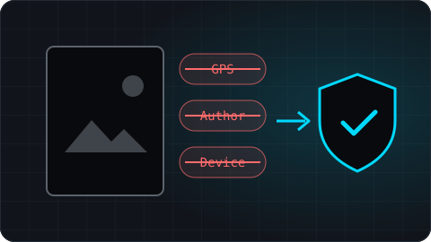
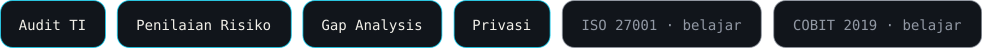

<!--
  Terjemahan Bahasa Indonesia dari README.md. Jaga agar isi kedua file tetap sama.
  Aset SVG lokal di ./assets dibuat dari kode dan tidak bergantung pada layanan pihak ketiga.
-->

[English](./README.md) · **Bahasa Indonesia**

 

  🛡️ <a href="https://www.credly.com/badges/8ecca716-0c24-4878-9329-4c014c34e4ca/public_url"><b>Cisco: Introduction to Cybersecurity</b></a> · Okt 2026 &nbsp;&nbsp;|&nbsp;&nbsp; 💼 Magang, Divisi Konsultan · <b>PT Pilar Teknotama Sinergi</b> · Jun 2026 – sekarang

## 🚀 Proyek Unggulan

<table>
<tr>
<td width="38%" valign="middle">

</td>
<td valign="middle">
<h3>Regulation Audit Assistant</h3>

Mengubah regulasi perbankan Indonesia menjadi kertas kerja audit TI. Dibantu AI, dengan setiap referensi pasal dicek terhadap teks sumber.

<code>Python</code> <code>FastAPI</code> <code>Gemini API</code>

<a href="https://github.com/kurniawan-Donn/regulation-audit-assistant">Repository →</a>

</td>
</tr>
<tr>
<td width="38%" valign="middle">

</td>
<td valign="middle">
<h3>DocxLint</h3>

Memeriksa ejaan, istilah asing, dan format dokumen Word berbahasa Indonesia. Berbasis aturan, berjalan lokal, dan hanya menerapkan perbaikan yang Anda setujui.

<code>Python</code> <code>Streamlit</code>

<a href="https://docxlint-id.streamlit.app">Demo live</a> · <a href="https://github.com/kurniawan-Donn/docxlint-app">Repository →</a>

</td>
</tr>
<tr>
<td width="38%" valign="middle">

</td>
<td valign="middle">
<h3>Metadata Remover</h3>

Menemukan dan menghapus metadata sensitif seperti lokasi GPS, nama pembuat, dan info perangkat dari file sebelum dibagikan.

<code>Python</code> <code>Streamlit</code>

<a href="https://metadata-remover-app-dk.streamlit.app">Demo live</a> · <a href="https://github.com/kurniawan-Donn/metadata-remover-streamlit">Repository →</a>

</td>
</tr>
</table>

  Lainnya di GitHub: <a href="https://xuping-afa.my.id/">Xuping Afa</a> (toko Laravel) · <a href="https://github.com/kurniawan-Donn/LumiNote">LumiNote</a> (Android) · <a href="https://github.com/kurniawan-Donn/Spinly-Android-Beta">Spinly</a> (Android, Firebase) · <a href="https://github.com/kurniawan-Donn/FItQuest_Android-Beta">FitQuest</a> (Android, beta)

## 🧰 Tech Stack

<table>
<tr>
<td width="140"><b>Bahasa</b></td>
<td></td>
</tr>
<tr>
<td><b>Tools Pengembangan</b></td>
<td></td>
</tr>
<tr>
<td><b>Audit TI &amp; Keamanan</b></td>
<td></td>
</tr>
</table>

## 📈 Aktivitas GitHub

<picture>
  <source media="(prefers-color-scheme: dark)" srcset="https://raw.githubusercontent.com/kurniawan-Donn/kurniawan-Donn/output/github-snake-dark.svg" />
  <source media="(prefers-color-scheme: light)" srcset="https://raw.githubusercontent.com/kurniawan-Donn/kurniawan-Donn/output/github-snake.svg" />
  
</picture>

  

---

Secure by Design. Auditable by Default.

