<!--
  Terjemahan Bahasa Indonesia dari README.md. Jaga agar isi kedua file tetap sama.
  Sumber utama kredensial dan pengalaman: https://portofoli-dony.vercel.app
-->

[English](./README.md) · **Bahasa Indonesia**

# Dony Kurniawan

[Tentang](#about) · [Kredensial](#credentials) · [Prinsip](#principles) · [Proyek](#projects) · [Tech Stack](#tech-stack) · [Belajar](#learning) · [Kontak](#contact)

---

## ⌨️ whoami

  

Saya mahasiswa tingkat akhir D3 Teknologi Informasi di **Politeknik Negeri Madiun** yang saat ini magang di Divisi Konsultan **PT Pilar Teknotama Sinergi**. Arah utama saya adalah **audit TI, tata kelola TI, dan GRC**: memeriksa apakah sistem punya kontrol yang tepat dan apakah kontrol itu benar-benar berjalan. Pengembangan software adalah keterampilan pendukung. Membangun tools membantu saya melihat di mana kontrol seharusnya ada dan di mana ia gagal.

**Terbuka untuk**

| | |
|:--|:--|
| **Peran sasaran** | IT Audit Intern · GRC / IT Risk Analyst · Junior IT Auditor |
| **Ketersediaan** | Sekarang, mulai Oktober 2026 |
| **Lokasi** | Yogyakarta, Indonesia (WIB, UTC+7) |
| **CV** | [Lihat CV (PDF)](https://atmwxcvrgscfkpnibgde.supabase.co/storage/v1/object/public/portfolio/cv/1790040648965-0.pdf) |

---

## 🎓 Kredensial

| | |
|:--|:--|
| 🛡️ **Sertifikasi** | [**Cisco: Introduction to Cybersecurity**](https://www.credly.com/badges/8ecca716-0c24-4878-9329-4c014c34e4ca/public_url) · Cisco Networking Academy · Oktober 2026 |
| 💼 **Magang** | Divisi Konsultan · PT Pilar Teknotama Sinergi · Juni 2026 – sekarang · Yogyakarta. Mengotomatiskan analisis regulasi TI dan penyusunan langkah audit dengan Python dan Gemini API. |

Daftar lengkap sertifikasi, pelatihan, dan pengalaman ada di <a href="https://portofoli-dony.vercel.app">portofolio saya →</a>

---

## 🔏 Secure by design, auditable by default: cara saya menerapkannya

- **Persetujuan sebelum perubahan.** [DocxLint](https://github.com/kurniawan-Donn/docxlint-app) tidak pernah mengubah diam-diam: setiap usulan perbaikan ditampilkan sebagai rencana perubahan, wajib dikonfirmasi, dan hanya diterapkan pada salinan dokumen asli.
- **Output AI yang bisa ditelusuri.** [Regulation Audit Assistant](https://github.com/kurniawan-Donn/regulation-audit-assistant) melampirkan referensi regulasi (BAB, pasal, halaman) di setiap persyaratan dan memvalidasinya terhadap teks sumber, sehingga saran AI bisa diperiksa, bukan dipercaya begitu saja.
- **Privasi lebih dulu.** [Metadata Remover](https://github.com/kurniawan-Donn/metadata-remover-streamlit) menunjukkan data tersembunyi apa saja yang dibawa sebuah file (lokasi GPS, nama pembuat, info perangkat) lalu menghapusnya sebelum file dibagikan.

---

## 🚀 Proyek Unggulan

Diurutkan berdasarkan relevansi dengan audit TI dan GRC.

<table>
<tr>
<td width="50%" valign="top">

### 🛡️ Regulation Audit Assistant

Mengubah regulasi perbankan Indonesia (POJK, SEOJK, PBI, PADK) menjadi kertas kerja audit TI dan checklist gap analysis. Dibantu AI, dengan setiap referensi pasal divalidasi terhadap teks sumber untuk mencegah halusinasi. Keputusan tetap di tangan auditor.

**Yang saya pelajari:** menjaga output AI tetap bisa ditelusuri dan ditinjau, sehingga AI mendukung penilaian auditor, bukan menggantikannya.

`Python` `FastAPI` `Gemini API` `Ekspor Excel / PDF`

<!-- [ISI: path screenshot] mis.  -->

[Repository](https://github.com/kurniawan-Donn/regulation-audit-assistant)

</td>
<td width="50%" valign="top">

### 📝 DocxLint

Memeriksa dokumen Word berbahasa Indonesia: salah eja, istilah asing yang belum di-*italic*, dan format yang tidak sesuai profil. Berjalan lokal dengan kamus berbasis aturan, tanpa AI generatif, dan hanya menerapkan perbaikan yang Anda setujui ke salinan dokumen.

**Yang saya pelajari:** memvalidasi file yang tidak tepercaya (struktur ZIP, makro, *path traversal*) sebelum dibaca, dan merancang alur kerja "tinjau dulu, baru ubah".

`Python` `Streamlit` `.docx`

[**Demo live**](https://docxlint-id.streamlit.app) · [Repository](https://github.com/kurniawan-Donn/docxlint-app)

</td>
</tr>
<tr>
<td width="50%" valign="top">

### 🥷 Metadata Remover

Menganalisis, mengklasifikasikan, dan menghapus metadata sensitif (lokasi GPS, nama pembuat, info perangkat) dari file PDF, gambar, Office, dan MP3 sebelum dibagikan ke publik.

**Yang saya pelajari:** betapa banyak informasi tersembunyi di file sehari-hari, dan bagaimana tiap format file menyimpannya dengan cara berbeda.

`Python` `Streamlit`

<!-- [ISI: path screenshot] mis.  -->

[**Demo live**](https://metadata-remover-app-dk.streamlit.app) · [Repository](https://github.com/kurniawan-Donn/metadata-remover-streamlit)

</td>
<td width="50%" valign="top">

### 💎 Xuping Afa

Toko web untuk pembelian dan pemasaran perhiasan xuping, dengan katalog produk untuk pelanggan dan akses berbasis peran untuk mengelola toko.

**Yang saya pelajari:** membangun dan men-deploy situs Laravel yang live, serta memisahkan apa yang boleh dilakukan pelanggan dan pengelola toko.

`Laravel` `PHP` `Blade`

<!-- [ISI: path screenshot] mis.  -->

[**Kunjungi situs**](https://xuping-afa.my.id/) · [Repository](https://github.com/kurniawan-Donn/Xuping-Afa)

</td>
</tr>
<tr>
<td width="50%" valign="top">

### 📒 LumiNote

Catatan, tugas, pengingat, kalender, dan statistik produktivitas dalam satu aplikasi Android. Data tersimpan di perangkat, jadi tetap bisa dipakai tanpa koneksi internet.

**Yang saya pelajari:** menyusun aplikasi Android dengan arsitektur MVVM dan menyimpan data secara lokal dengan Room.

`Kotlin` `MVVM` `Room` `Material Design`

  
  

[Repository](https://github.com/kurniawan-Donn/LumiNote)

</td>
<td width="50%" valign="top">

### 🎲 Spinly

Spinner acak multiplayer. Pemain bergabung ke room dengan kode room dan melihat hasil yang sama pada saat yang sama, tersinkron secara real-time.

**Yang saya pelajari:** menyinkronkan state bersama antarperangkat secara real-time dengan Cloud Firestore, di balik Firebase Authentication.

`Kotlin` `Firebase Auth` `Cloud Firestore`

<!-- [ISI: path screenshot atau GIF] mis.  -->

[Repository](https://github.com/kurniawan-Donn/Spinly-Android-Beta)

</td>
</tr>
</table>

Juga di GitHub: <a href="https://github.com/kurniawan-Donn/FItQuest_Android-Beta"><b>FitQuest</b></a>, aplikasi fitness Android versi beta (Kotlin, Jetpack Compose, Firebase), dan <a href="https://github.com/kurniawan-Donn/Porto_dnyy"><b>situs portofolio saya</b></a> (Next.js, TypeScript).

 

---

## 🧰 Tech Stack

**Audit, tata kelola, dan keamanan:** `Audit TI` `Tata kelola TI` `GRC` `Penilaian risiko` `Analisis sistem` `Privasi`
 
**Bahasa pemrograman:** Python · PHP · Kotlin · JavaScript · TypeScript · HTML · CSS
 
**Framework dan tools:** Laravel · FastAPI · Streamlit · Next.js · Tailwind CSS · Android Studio · Git · GitHub · Figma · VS Code
 
**Database dan layanan backend:** MySQL · SQLite · PostgreSQL · Firebase · Supabase

  

Dipakai di proyek: Python, PHP, Kotlin, Laravel, FastAPI, Streamlit, MySQL, Firebase, Room di atas SQLite. Sedang dipelajari: Next.js, TypeScript, Supabase. Daftar ini gabungan pengalaman proyek dan pembelajaran yang sedang berjalan, bukan tingkat kemahiran yang sama di setiap tool.

---

## 📚 Peta Belajar

| Bidang | Fokus saat ini | Status | Target | Mengapa penting untuk jalur saya |
|:--|:--|:--|:--|:--|
| **Framework audit TI** | ISO 27001 | 🟦 Berjalan | Q1 2027 | Acuan umum untuk sistem manajemen keamanan informasi beserta kontrolnya |
| **Tata kelola TI** | COBIT 2019 | ⬜ Direncanakan | Q2 2027 | Menghubungkan proses TI dengan tujuan tata kelola dan manajemen |
| **Keamanan siber** | Analisis jaringan, threat modeling | 🟦 Berjalan | Q4 2026 | Lanjutan kursus Cisco: bagaimana sistem diserang dan di mana pengamanan dibutuhkan |
| **Otomasi Python** | Skrip audit dan pemrosesan dokumen | 🟦 Berjalan | Berkelanjutan | Mengurangi pekerjaan manual berulang saat meninjau dokumen dan bukti |
| **AI yang bertanggung jawab** | Alur kerja berbantuan AI dengan tinjauan manusia | 🟦 Berjalan | Berkelanjutan | Output AI perlu diverifikasi sebelum dipakai dalam pekerjaan audit |
| **Web stack modern** | Next.js, TypeScript, Supabase | 🟦 Berjalan | Berkelanjutan | Memperluas cara saya membangun dan memahami aplikasi modern |

Target adalah sasaran pribadi, bukan hasil yang sudah tercapai.

---

## 📈 Aktivitas GitHub

<picture>
  <source media="(prefers-color-scheme: dark)" srcset="https://raw.githubusercontent.com/kurniawan-Donn/kurniawan-Donn/output/github-snake-dark.svg" />
  <source media="(prefers-color-scheme: light)" srcset="https://raw.githubusercontent.com/kurniawan-Donn/kurniawan-Donn/output/github-snake.svg" />
  
</picture>

<!-- Kartu pihak ketiga opsional. Hapus penanda komentar untuk mengaktifkan.

-->

---

## 📫 Hubungi Saya

Saya terbuka untuk **peran audit TI, GRC, dan risiko TI**, baik magang maupun posisi entry-level, serta kolaborasi teknis di bidang tersebut. Jika Anda sedang mengerjakan sesuatu di sana, saya senang mendengarnya.

- **Email:** [donykurniawan1298@gmail.com](mailto:donykurniawan1298@gmail.com)
- **LinkedIn:** [Dony Kurniawan](https://www.linkedin.com/in/dony-kurniawan-7b04bb291)
- **Portfolio:** [portofoli-dony.vercel.app](https://portofoli-dony.vercel.app)
- **CV:** [PDF](https://atmwxcvrgscfkpnibgde.supabase.co/storage/v1/object/public/portfolio/cv/1790040648965-0.pdf)
- **GitHub:** [@kurniawan-Donn](https://github.com/kurniawan-Donn)

