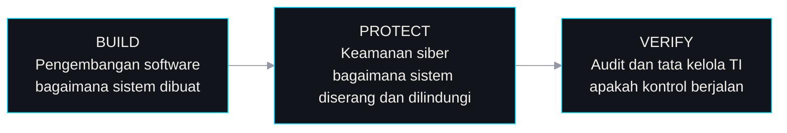

<!--
  Terjemahan Bahasa Indonesia dari README.md. Jaga agar isi kedua file tetap sama.
-->

<div align="center">

[English](./README.md) · **Bahasa Indonesia**

# Dony Kurniawan


[](https://portofoli-dony.vercel.app)
[](https://www.linkedin.com/in/dony-kurniawan-7b04bb291)
[](mailto:donykurniawan1298@gmail.com)
[](https://github.com/kurniawan-Donn)

[Tentang](#about) · [Proyek](#projects) · [Tech Stack](#tech-stack) · [Belajar](#learning) · [Aktivitas](#activity) · [Kontak](#contact)

</div>

---

<a id="about"></a>

## ⌨️ whoami

```yaml
# ~/profile.yml
nama: Dony Kurniawan
pendidikan: D3 Teknologi Informasi @ Politeknik Negeri Madiun (tingkat akhir)
lokasi: Indonesia 🇮🇩

fokus:
  utama:      [audit TI, tata kelola TI]
  pendukung:  [keamanan siber, penilaian risiko, pengembangan software, otomasi Python]

sedang_dipelajari: [ISO 27001, COBIT 2019, threat modeling, Next.js, TypeScript, Supabase]
terbuka_untuk:     [magang, posisi IT entry-level, kolaborasi teknis]

prinsip:
  - "Secure by design, auditable by default."
  - "Build to understand. Create to solve."
```

Saya suka memahami cara kerja sistem, di mana risiko muncul, dan bagaimana kontrol yang praktis membuat teknologi lebih aman dan andal. Minat karier utama saya adalah **audit TI**: memeriksa apakah sistem memiliki kontrol yang tepat dan apakah kontrol itu bekerja sebagaimana mestinya. Saya mendekatinya lewat tiga bidang yang saling terhubung:



---

<a id="projects"></a>

## 🚀 Proyek Unggulan

<table>
<tr>
<td width="50%" valign="top">

### 📝 DocxLint


Memeriksa dokumen Word berbahasa Indonesia: salah eja, istilah asing yang belum di-*italic*, dan format yang tidak sesuai profil. Berjalan lokal dengan kamus berbasis aturan, tanpa AI generatif, dan hanya menerapkan perbaikan yang Anda setujui ke salinan dokumen.

`Python` `Streamlit` `.docx`

[**Demo live**](https://docxlint-id.streamlit.app) · [Repository](https://github.com/kurniawan-Donn/docxlint-app)

</td>
<td width="50%" valign="top">

### 🛡️ Regulation Audit Assistant


Mengubah regulasi perbankan Indonesia (POJK, SEOJK, PBI, PADK) menjadi kertas kerja audit TI dan checklist gap analysis. Dibantu AI, dengan setiap referensi pasal divalidasi terhadap teks sumber untuk mencegah halusinasi. Keputusan tetap di tangan auditor.

`Python` `FastAPI` `Gemini API` `Ekspor Excel / PDF`

[Repository](https://github.com/kurniawan-Donn/regulation-audit-assistant)

</td>
</tr>
<tr>
<td width="50%" valign="top">

### 🥷 Metadata Remover


Menganalisis, mengklasifikasikan, dan menghapus metadata sensitif (lokasi GPS, nama pembuat, info perangkat) dari file sebelum dibagikan ke publik.

`Python` `Streamlit`

[**Demo live**](https://metadata-remover-app-dk.streamlit.app) · [Repository](https://github.com/kurniawan-Donn/metadata-remover-streamlit)

</td>
<td width="50%" valign="top">

### 💎 Xuping Afa


Toko web untuk pembelian dan pemasaran perhiasan xuping, dengan katalog produk untuk pelanggan dan akses berbasis peran untuk mengelola toko.

`Laravel` `PHP` `Blade`

[**Kunjungi situs**](https://xuping-afa.my.id/) · [Repository](https://github.com/kurniawan-Donn/Xuping-Afa)

</td>
</tr>
<tr>
<td width="50%" valign="top">

### 📒 LumiNote


Catatan, tugas, pengingat, kalender, dan statistik produktivitas dalam satu aplikasi Android. Data tersimpan di perangkat, jadi tetap bisa dipakai tanpa koneksi internet.

`Kotlin` `MVVM` `Room` `Material Design`

[Repository](https://github.com/kurniawan-Donn/LumiNote)

</td>
<td width="50%" valign="top">

### 🎲 Spinly


Spinner acak multiplayer. Pemain bergabung ke room dengan kode room dan melihat hasil yang sama pada saat yang sama, tersinkron secara real-time.

`Kotlin` `Firebase Auth` `Cloud Firestore`

[Repository](https://github.com/kurniawan-Donn/Spinly-Android-Beta)

</td>
</tr>
</table>

<sub>Juga di GitHub: <a href="https://github.com/kurniawan-Donn/FItQuest_Android-Beta"><b>FitQuest</b></a>, aplikasi fitness Android versi beta (Kotlin, Jetpack Compose, Firebase), dan <a href="https://github.com/kurniawan-Donn/Porto_dnyy"><b>situs portofolio saya</b></a> (Next.js, TypeScript).</sub>

<div align="center">

<br />

[](https://github.com/kurniawan-Donn?tab=repositories)

</div>

---

<a id="tech-stack"></a>

## 🧰 Tech Stack

<div align="center">

**Bahasa pemrograman**
<br /><br />


**Framework dan tools**
<br /><br />

<br />


**Database dan layanan backend**
<br /><br />


**Audit, tata kelola, dan keamanan**
<br /><br />
`Audit TI` `Tata kelola TI` `Penilaian risiko` `Analisis sistem` `Privasi`

<sub>Dipakai di proyek: Python, PHP, Kotlin, Laravel, FastAPI, Streamlit, MySQL, Firebase, Room di atas SQLite. Sedang dipelajari: Next.js, TypeScript, Supabase.<br />Daftar ini gabungan pengalaman proyek dan pembelajaran yang sedang berjalan, bukan tingkat kemahiran yang sama di setiap tool.</sub>

</div>

---

<a id="learning"></a>

## 📚 Peta Belajar

| Bidang | Fokus saat ini | Mengapa penting untuk jalur saya |
|:--|:--|:--|
| **Framework audit TI** | ISO 27001, COBIT 2019 | Acuan umum untuk manajemen keamanan informasi dan tata kelola TI |
| **Keamanan siber** | Analisis jaringan, threat modeling | Menunjukkan bagaimana sistem bisa diserang dan di mana pengamanan dibutuhkan |
| **Otomasi Python** | Skrip audit dan pemrosesan dokumen | Mengurangi pekerjaan manual berulang saat meninjau dokumen dan bukti |
| **AI yang bertanggung jawab** | Alur kerja berbantuan AI dengan tinjauan manusia | Output AI perlu diverifikasi sebelum dipakai dalam pekerjaan audit |
| **Web stack modern** | Next.js, TypeScript, Supabase | Memperluas cara saya membangun dan memahami aplikasi modern |

---

<a id="activity"></a>

## 📈 Aktivitas GitHub

<div align="center">

<picture>
  <source media="(prefers-color-scheme: dark)" srcset="https://raw.githubusercontent.com/kurniawan-Donn/kurniawan-Donn/output/github-snake-dark.svg" />
  <source media="(prefers-color-scheme: light)" srcset="https://raw.githubusercontent.com/kurniawan-Donn/kurniawan-Donn/output/github-snake.svg" />
  
</picture>

<br /><br />


<sub>Kartu-kartu ini berasal dari layanan pihak ketiga dan sesekali bisa tidak tersedia. Statistik bahasa menggambarkan isi repository, bukan tingkat keahlian secara keseluruhan.</sub>

</div>

---

<a id="contact"></a>

## 📫 Hubungi Saya

Saya terbuka untuk **magang, posisi IT entry-level, dan kolaborasi teknis**, terutama di bidang audit TI, tata kelola, keamanan siber, dan pekerjaan terkait risiko. Jika Anda sedang mengerjakan sesuatu di bidang tersebut, saya senang mendengarnya.

- **Portfolio:** [portofoli-dony.vercel.app](https://portofoli-dony.vercel.app)
- **LinkedIn:** [Dony Kurniawan](https://www.linkedin.com/in/dony-kurniawan-7b04bb291)
- **Email:** [donykurniawan1298@gmail.com](mailto:donykurniawan1298@gmail.com)
- **GitHub:** [@kurniawan-Donn](https://github.com/kurniawan-Donn)

<div align="center">

<br />


</div>
