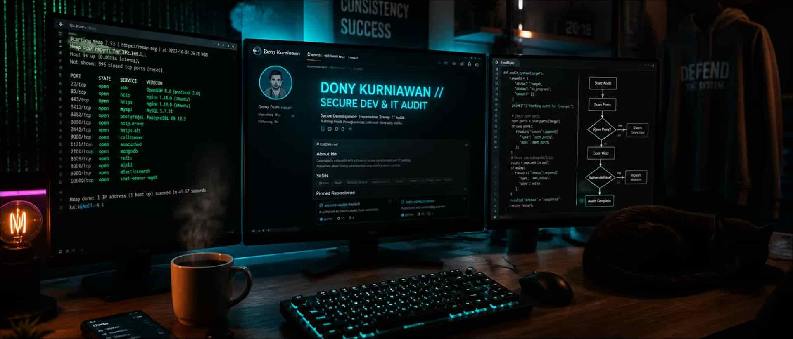
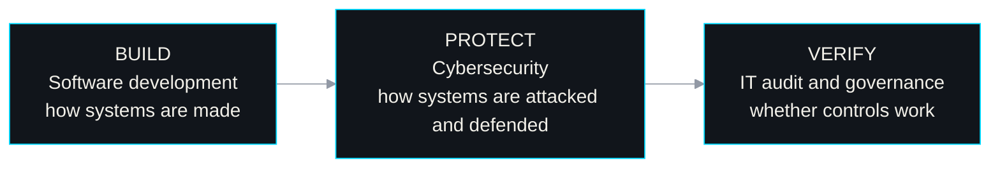
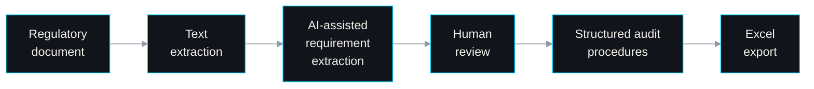
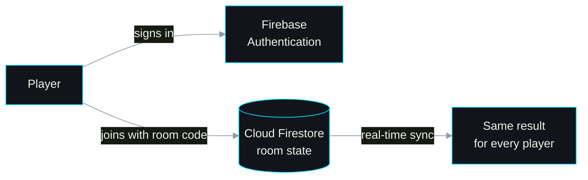

<!--
  GitHub profile README — github.com/kurniawan-Donn
  Visual direction: Secure Systems / Technical Editorial
  Palette: #080A0D · #11151B · #F2F0E9 · #00D9FF · #9299A5 · #70E1A1

  TODO before publishing:
  1. Verify each project repository URL (see comments inside each project).
  2. Add the real LinkedIn URL (see the Contact section).
  3. Make sure ./assets/banner-dony.jpg exists in this repository.
-->

# Dony Kurniawan

Final-year D3 Information Technology student at **Politeknik Negeri Madiun**, Indonesia 🇮🇩

I like understanding how systems work, where risks emerge, and how practical controls make technology more secure and reliable.

[About](#about) · [Projects](#featured-projects) · [Tech Stack](#tech-stack) · [Learning](#learning-roadmap) · [Contact](#get-in-touch)

 

| At a glance | |
|:--|:--|
| **Education** | D3 Information Technology, Politeknik Negeri Madiun (final year) |
| **Primary direction** | IT Audit and IT Governance |
| **Supporting areas** | Cybersecurity, risk assessment, software development, Python automation |
| **Currently learning** | ISO 27001, COBIT 2019, threat modeling, Next.js, TypeScript, Supabase |
| **Open to** | Internships · entry-level IT roles · technical collaboration |

---

## About

> A technology enthusiast focused on understanding systems, identifying risks, and building practical solutions through IT audit, security, and software development.

My main career interest is **IT audit**: checking whether systems have appropriate controls, whether those controls work as intended, and where technology-related risks need attention. I approach it through three connected areas:

- **Software development** shows me how applications are actually built, and where controls belong or fail.
- **Cybersecurity** helps me understand threats and the technical safeguards that counter them.
- **IT audit and governance** give me the framework to evaluate controls, compliance, and risk.

**Principles:** *Secure by design, auditable by default.* · *Build to understand. Create to solve.*

---

## Featured Projects

### 🔐 Regulation Audit Assistant

**Problem.** Public IT regulations are long, and turning them into consistent audit procedures by hand is slow and repetitive.

**Approach.** An exploration of Python-assisted document processing and AI to extract requirements from regulatory documents and organize them into structured audit procedures, with Excel as the target output. The project is exploratory, and AI-extracted results must be reviewed by a human before any real audit use.

**Stack.** `Python` `PDF processing` `AI-assisted workflows` `Excel`

<b>View the intended workflow</b> (conceptual)

 

This shows the design intent, not a list of finished features. Human review is a deliberate step because audit conclusions should never rest on unverified AI output.

<!-- TODO: add the verified repository link:
[View repository →](https://github.com/kurniawan-Donn/REPLACE-WITH-REPOSITORY-NAME)
TODO: once features land, add a short "Implemented / Planned" list so the status stays accurate. -->

 

### 📱 LumiNote

**Problem.** Note-taking apps are hard to rely on when the connection is unreliable.

**What it does.** An offline-first notes and tasks app that works fully without an internet connection, using local storage for everyday data.

**Stack.** `Kotlin` `Android` `Room`

<!-- TODO: add the verified LumiNote repository link.
     Unverified candidate from an earlier draft (do not publish until checked): https://github.com/kurniawan-Donn/LumiNote -->

 

### 🎲 Spinly

**Problem.** Group decisions work best when everyone sees the same result at the same moment.

**What it does.** A multiplayer random spinner. Users join a room with a room code and see the same result in real time.

**Stack.** `Android` `Firebase Authentication` `Cloud Firestore`

<b>View how room sync works</b> (simplified)

 

<!-- TODO: add the verified Spinly repository link, and confirm the implementation language. -->

 

### 🌐 Internship Program CMS

**Problem.** Internship program information tends to end up scattered across different places.

**What it does.** A web-based content management system for managing internship program information, activity galleries, alumni data, and FAQs in one place.

**Stack.** `Laravel` `PHP` `MySQL`

<!-- TODO: add the verified Internship Program CMS repository link. -->

 

---

## Tech Stack

**Languages**
 

Used in projects: PHP, Python, Kotlin.

**Frameworks and tools**
 

Used in projects: Laravel, Android Studio. Learning: Next.js.

**Databases and backend services**
 

Used in projects: MySQL, Firebase (Authentication and Firestore), Room on SQLite. Learning: Supabase.

**Audit, governance, and security interests**
 
`IT audit` `IT governance` `Risk assessment` `System analysis`

The technologies above reflect a mix of project experience and ongoing learning, not equal proficiency in every tool.

---

## Learning Roadmap

| Area | Current focus | Why it matters to my path |
|:--|:--|:--|
| **IT audit frameworks** | ISO 27001, COBIT 2019 | Common reference points for information security management and IT governance |
| **Cybersecurity** | Network analysis, threat modeling | Shows how systems can be attacked and where safeguards belong |
| **Python automation** | Audit and document-processing scripts | Reduces repetitive manual work when reviewing documents and evidence |
| **Responsible AI** | Human-reviewed AI-assisted workflows | AI output needs verification before it is used in audit work |
| **Modern web stack** | Next.js, TypeScript, Supabase | Broadens how I build and understand modern applications |

---

## GitHub Activity

These cards come from a third-party service and may occasionally be unavailable. Language statistics describe repository contents, not overall skill.

---

## Get in Touch

I'm open to **internships, entry-level IT roles, and technical collaboration**, especially in IT audit, governance, cybersecurity, and risk-related work. If you're working on something in those areas, I'd be glad to hear from you.

- **Portfolio:** [portofolio-dony.vercel.app](https://portofolio-dony.vercel.app)
- **Email:** [donykurniawan128@gmail.com](mailto:donykurniawan128@gmail.com)
- **GitHub:** [@kurniawan-Donn](https://github.com/kurniawan-Donn)
<!-- TODO: add LinkedIn once the real URL is known:
- **LinkedIn:** [your name](https://www.linkedin.com/in/YOUR-REAL-USERNAME) -->

 

