<!--
  GitHub profile README — github.com/kurniawan-Donn
  Visual direction: Secure Systems / Technical Editorial
  Palette: #080A0D · #11151B · #F2F0E9 · #00D9FF · #9299A5 · #70E1A1
  Translations: README.id.md (Bahasa Indonesia). Keep both files in sync.
  Source of truth for credentials and experience: https://portofoli-dony.vercel.app
  Snake animation: generated daily by .github/workflows/snake.yml into the `output` branch.
  whoami cards: assets/whoami.svg and assets/whoami-id.svg (no third-party service).
-->

**English** · [Bahasa Indonesia](./README.id.md)

# Dony Kurniawan

[About](#about) · [Credentials](#credentials) · [Principles](#principles) · [Projects](#projects) · [Tech Stack](#tech-stack) · [Learning](#learning) · [Contact](#contact)

---

## ⌨️ whoami

  

I'm a final-year D3 Information Technology student at **Politeknik Negeri Madiun**, currently interning in the Consultant Division of **PT Pilar Teknotama Sinergi**. My main direction is **IT audit, IT governance, and GRC**: checking whether systems have the right controls and whether those controls actually work. Software development is a supporting skill. Building tools shows me where controls belong and where they fail.

**Open to**

| | |
|:--|:--|
| **Target roles** | IT Audit Intern · GRC / IT Risk Analyst · Junior IT Auditor |
| **Availability** | Now, from October 2026 |
| **Location** | Yogyakarta, Indonesia (WIB, UTC+7) |
| **CV** | [View CV (PDF)](https://atmwxcvrgscfkpnibgde.supabase.co/storage/v1/object/public/portfolio/cv/1790040648965-0.pdf) |

---

## 🎓 Credentials

| | |
|:--|:--|
| 🛡️ **Certification** | [**Cisco: Introduction to Cybersecurity**](https://www.credly.com/badges/8ecca716-0c24-4878-9329-4c014c34e4ca/public_url) · Cisco Networking Academy · October 2026 |
| 💼 **Internship** | Consultant Division · PT Pilar Teknotama Sinergi · June 2026 – present · Yogyakarta. Automating IT regulation analysis and audit-step drafting with Python and the Gemini API. |

Full list of certifications, training, and experience on my <a href="https://portofoli-dony.vercel.app">portfolio →</a>

---

## 🔏 Secure by design, auditable by default: how I apply it

- **Approval before change.** [DocxLint](https://github.com/kurniawan-Donn/docxlint-app) never edits silently: every proposed fix is shown as a change plan, needs explicit confirmation, and is applied only to a copy of the original document.
- **Traceable AI output.** [Regulation Audit Assistant](https://github.com/kurniawan-Donn/regulation-audit-assistant) attaches a regulation reference (chapter, article, page) to every requirement and validates it against the source text, so AI suggestions can be checked instead of trusted blindly.
- **Privacy first.** [Metadata Remover](https://github.com/kurniawan-Donn/metadata-remover-streamlit) shows what hidden data a file carries (GPS location, author, device details) and strips it before the file is shared.

---

## 🚀 Featured Projects

Ordered by relevance to IT audit and GRC.

<table>
<tr>
<td width="50%" valign="top">

### 🛡️ Regulation Audit Assistant

Turns Indonesian banking regulations (POJK, SEOJK, PBI, PADK) into IT audit working papers and gap-analysis checklists. AI-assisted, with every article reference validated against the source text to catch hallucinations. The auditor stays the decision-maker.

**What I learned:** how to keep AI output traceable and reviewable, so it supports an auditor's judgment instead of replacing it.

`Python` `FastAPI` `Gemini API` `Excel / PDF export`

<!-- [ISI: screenshot path] e.g.  -->

[Repository](https://github.com/kurniawan-Donn/regulation-audit-assistant)

</td>
<td width="50%" valign="top">

### 📝 DocxLint

Checks Indonesian-language Word documents for spelling mistakes, foreign terms that are not italicized, and formatting that breaks a profile. Runs locally on rule-based dictionaries, with no generative AI, and applies only the fixes you approve, to a copy of the document.

**What I learned:** validating untrusted files (ZIP structure, macros, path traversal) before parsing them, and designing review-before-change workflows.

`Python` `Streamlit` `.docx`

[**Live demo**](https://docxlint-id.streamlit.app) · [Repository](https://github.com/kurniawan-Donn/docxlint-app)

</td>
</tr>
<tr>
<td width="50%" valign="top">

### 🥷 Metadata Remover

Analyzes, classifies, and strips sensitive metadata (GPS location, author names, device details) from PDF, image, Office, and MP3 files before they are shared publicly.

**What I learned:** how much hidden information everyday files carry, and how each file format stores it differently.

`Python` `Streamlit`

<!-- [ISI: screenshot path] e.g.  -->

[**Live demo**](https://metadata-remover-app-dk.streamlit.app) · [Repository](https://github.com/kurniawan-Donn/metadata-remover-streamlit)

</td>
<td width="50%" valign="top">

### 💎 Xuping Afa

A web store for buying and marketing xuping jewelry, with a product catalog for customers and role-based access for managing the store.

**What I learned:** building and deploying a live Laravel site, and separating what customers and store managers are allowed to do.

`Laravel` `PHP` `Blade`

<!-- [ISI: screenshot path] e.g.  -->

[**Visit site**](https://xuping-afa.my.id/) · [Repository](https://github.com/kurniawan-Donn/Xuping-Afa)

</td>
</tr>
<tr>
<td width="50%" valign="top">

### 📒 LumiNote

Notes, tasks, reminders, a calendar, and productivity statistics in one Android app. Data lives on the device, so it keeps working without an internet connection.

**What I learned:** structuring an Android app with MVVM and keeping data local with Room.

`Kotlin` `MVVM` `Room` `Material Design`

  
  

[Repository](https://github.com/kurniawan-Donn/LumiNote)

</td>
<td width="50%" valign="top">

### 🎲 Spinly

A multiplayer random spinner. Players join a room with a room code and see the same result at the same moment, synced in real time.

**What I learned:** syncing shared state between devices in real time with Cloud Firestore, behind Firebase Authentication.

`Kotlin` `Firebase Auth` `Cloud Firestore`

<!-- [ISI: screenshot or GIF path] e.g.  -->

[Repository](https://github.com/kurniawan-Donn/Spinly-Android-Beta)

</td>
</tr>
</table>

Also on GitHub: <a href="https://github.com/kurniawan-Donn/FItQuest_Android-Beta"><b>FitQuest</b></a>, an Android fitness app in beta (Kotlin, Jetpack Compose, Firebase), and <a href="https://github.com/kurniawan-Donn/Porto_dnyy"><b>my portfolio site</b></a> (Next.js, TypeScript).

 

---

## 🧰 Tech Stack

**Audit, governance, and security:** `IT audit` `IT governance` `GRC` `Risk assessment` `System analysis` `Privacy`
 
**Languages:** Python · PHP · Kotlin · JavaScript · TypeScript · HTML · CSS
 
**Frameworks and tools:** Laravel · FastAPI · Streamlit · Next.js · Tailwind CSS · Android Studio · Git · GitHub · Figma · VS Code
 
**Databases and backend services:** MySQL · SQLite · PostgreSQL · Firebase · Supabase

  

Used in projects: Python, PHP, Kotlin, Laravel, FastAPI, Streamlit, MySQL, Firebase, Room on SQLite. Learning: Next.js, TypeScript, Supabase. This is a mix of project experience and ongoing learning, not equal proficiency in every tool.

---

## 📚 Learning Roadmap

| Area | Current focus | Status | Target | Why it matters to my path |
|:--|:--|:--|:--|:--|
| **IT audit frameworks** | ISO 27001 | 🟦 In progress | Q1 2027 | Common reference for information security management systems and their controls |
| **IT governance** | COBIT 2019 | ⬜ Planned | Q2 2027 | Links IT processes to governance and management objectives |
| **Cybersecurity** | Network analysis, threat modeling | 🟦 In progress | Q4 2026 | Builds on the Cisco course: how systems are attacked and where safeguards belong |
| **Python automation** | Audit and document-processing scripts | 🟦 In progress | Ongoing | Reduces repetitive manual work when reviewing documents and evidence |
| **Responsible AI** | Human-reviewed AI-assisted workflows | 🟦 In progress | Ongoing | AI output needs verification before it is used in audit work |
| **Modern web stack** | Next.js, TypeScript, Supabase | 🟦 In progress | Ongoing | Broadens how I build and understand modern applications |

Targets are personal goals, not completed results.

---

## 📈 GitHub Activity

<picture>
  <source media="(prefers-color-scheme: dark)" srcset="https://raw.githubusercontent.com/kurniawan-Donn/kurniawan-Donn/output/github-snake-dark.svg" />
  <source media="(prefers-color-scheme: light)" srcset="https://raw.githubusercontent.com/kurniawan-Donn/kurniawan-Donn/output/github-snake.svg" />
  
</picture>

<!-- Optional third-party cards. Remove the comment markers to enable them.

-->

---

## 📫 Get in Touch

I'm open to **IT audit, GRC, and IT risk roles**, either internships or entry-level positions, plus technical collaboration in those areas. If you're working on something there, I'd be glad to hear from you.

- **Email:** [donykurniawan1298@gmail.com](mailto:donykurniawan1298@gmail.com)
- **LinkedIn:** [Dony Kurniawan](https://www.linkedin.com/in/dony-kurniawan-7b04bb291)
- **Portfolio:** [portofoli-dony.vercel.app](https://portofoli-dony.vercel.app)
- **CV:** [PDF](https://atmwxcvrgscfkpnibgde.supabase.co/storage/v1/object/public/portfolio/cv/1790040648965-0.pdf)
- **GitHub:** [@kurniawan-Donn](https://github.com/kurniawan-Donn)

