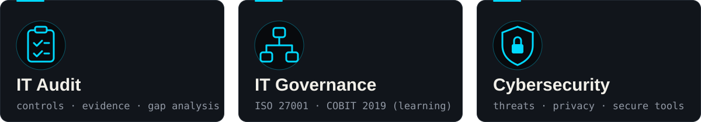
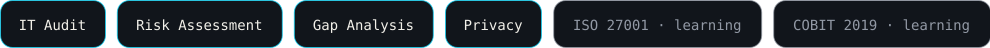

<!--
  GitHub profile README — github.com/kurniawan-Donn
  Direction: visual-first, minimal text. Palette: #080A0D · #11151B · #F2F0E9 · #00D9FF · #9299A5 · #70E1A1
  Translation: README.id.md. Keep both files in sync.
  Local SVG assets in ./assets are generated from code; they need no third-party service.
  Snake animation: generated daily by .github/workflows/snake.yml into the `output` branch.
-->

**English** · [Bahasa Indonesia](./README.id.md)

 

  🛡️ <a href="https://www.credly.com/badges/8ecca716-0c24-4878-9329-4c014c34e4ca/public_url"><b>Cisco: Introduction to Cybersecurity</b></a> · Oct 2026 &nbsp;&nbsp;|&nbsp;&nbsp; 💼 Intern, Consultant Division · <b>PT Pilar Teknotama Sinergi</b> · Jun 2026 – present

## 🚀 Featured Projects

<table>
<tr>
<td width="38%" valign="middle">

</td>
<td valign="middle">
<h3>Regulation Audit Assistant</h3>

Turns Indonesian banking regulations into IT audit working papers. AI-assisted, with every article reference checked against the source.

<code>Python</code> <code>FastAPI</code> <code>Gemini API</code>

<a href="https://github.com/kurniawan-Donn/Regulation-Audit-Assistant">Repository →</a>

</td>
</tr>
<tr>
<td width="38%" valign="middle">

</td>
<td valign="middle">
<h3>PILARA</h3>

Internship management system for PT Pilar Teknotama Sinergi: registration, daily logbooks, attendance, and assessment. Built with role-based access, an activity log, and verifiable letters.

<code>Laravel</code> <code>PHP</code> <code>Tailwind CSS</code>

<a href="https://github.com/kurniawan-Donn/pilara-pitsi">Repository →</a>

</td>
</tr>
<tr>
<td width="38%" valign="middle">

</td>
<td valign="middle">
<h3>DocxLint</h3>

Checks Indonesian Word documents for spelling, foreign terms, and formatting. Rule-based, local, and applies only the fixes you approve.

<code>Python</code> <code>Streamlit</code>

<a href="https://docxlint-id.streamlit.app">Live demo</a> · <a href="https://github.com/kurniawan-Donn/docxlint-app">Repository →</a>

</td>
</tr>
</table>

  More on GitHub: <a href="https://github.com/kurniawan-Donn/Metadata-Remover">Metadata Remover</a> (Python, <a href="https://metadata-remover-app-dk.streamlit.app">live demo</a>) · <a href="https://xuping-afa.my.id/">Xuping Afa</a> (Laravel store) · <a href="https://github.com/kurniawan-Donn/LumiNote">LumiNote</a> (Android) · <a href="https://github.com/kurniawan-Donn/Spinly-Android-Beta">Spinly</a> (Android, Firebase) · <a href="https://github.com/kurniawan-Donn/FItQuest_Android-Beta">FitQuest</a> (Android, beta)

## 🧰 Tech Stack

<table>
<tr>
<td width="140"><b>Languages</b></td>
<td></td>
</tr>
<tr>
<td><b>Development Tools</b></td>
<td></td>
</tr>
<tr>
<td><b>IT Audit &amp; Security</b></td>
<td></td>
</tr>
</table>

## 📈 GitHub Activity

<picture>
  <source media="(prefers-color-scheme: dark)" srcset="https://raw.githubusercontent.com/kurniawan-Donn/kurniawan-Donn/output/github-snake-dark.svg" />
  <source media="(prefers-color-scheme: light)" srcset="https://raw.githubusercontent.com/kurniawan-Donn/kurniawan-Donn/output/github-snake.svg" />
  
</picture>

  

---

Secure by Design. Auditable by Default.

