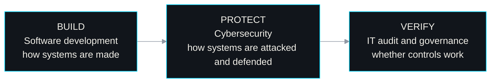

<!--
  GitHub profile README — github.com/kurniawan-Donn
  Visual direction: Secure Systems / Technical Editorial
  Palette: #080A0D · #11151B · #F2F0E9 · #00D9FF · #9299A5 · #70E1A1
  Translations: README.id.md (Bahasa Indonesia). Keep both files in sync.
  Snake animation: generated daily by .github/workflows/snake.yml into the `output` branch.
-->

<div align="center">

**English** · [Bahasa Indonesia](./README.id.md)

# Dony Kurniawan


[](https://portofoli-dony.vercel.app)
[](https://www.linkedin.com/in/dony-kurniawan-7b04bb291)
[](mailto:donykurniawan1298@gmail.com)
[](https://github.com/kurniawan-Donn)

[About](#about) · [Projects](#projects) · [Tech Stack](#tech-stack) · [Learning](#learning) · [Activity](#activity) · [Contact](#contact)

</div>

---

<a id="about"></a>

## ⌨️ whoami

```yaml
# ~/profile.yml
name: Dony Kurniawan
education: D3 Information Technology @ Politeknik Negeri Madiun (final year)
location: Indonesia 🇮🇩

focus:
  primary:    [IT audit, IT governance]
  supporting: [cybersecurity, risk assessment, software development, Python automation]

currently_learning: [ISO 27001, COBIT 2019, threat modeling, Next.js, TypeScript, Supabase]
open_to:            [internships, entry-level IT roles, technical collaboration]

principles:
  - "Secure by design, auditable by default."
  - "Build to understand. Create to solve."
```

I like understanding how systems work, where risks emerge, and how practical controls make technology more secure and reliable. My main career interest is **IT audit**: checking whether systems have appropriate controls and whether those controls work as intended. I get there through three connected areas:



---

<a id="projects"></a>

## 🚀 Featured Projects

<table>
<tr>
<td width="50%" valign="top">

### 📝 DocxLint


Checks Indonesian-language Word documents for spelling mistakes, foreign terms that are not italicized, and formatting that breaks a profile. Runs locally on rule-based dictionaries, with no generative AI, and applies only the fixes you approve, to a copy of the document.

`Python` `Streamlit` `.docx`

[**Live demo**](https://docxlint-id.streamlit.app) · [Repository](https://github.com/kurniawan-Donn/docxlint-app)

</td>
<td width="50%" valign="top">

### 🛡️ Regulation Audit Assistant


Turns Indonesian banking regulations (POJK, SEOJK, PBI, PADK) into IT audit working papers and gap-analysis checklists. AI-assisted, with every article reference validated against the source text to catch hallucinations. The auditor stays the decision-maker.

`Python` `FastAPI` `Gemini API` `Excel / PDF export`

[Repository](https://github.com/kurniawan-Donn/regulation-audit-assistant)

</td>
</tr>
<tr>
<td width="50%" valign="top">

### 🥷 Metadata Remover


Analyzes, classifies, and strips sensitive metadata (GPS location, author names, device details) from files before they are shared publicly.

`Python` `Streamlit`

[**Live demo**](https://metadata-remover-app-dk.streamlit.app) · [Repository](https://github.com/kurniawan-Donn/metadata-remover-streamlit)

</td>
<td width="50%" valign="top">

### 💎 Xuping Afa


A web store for buying and marketing xuping jewelry, with a product catalog for customers and role-based access for managing the store.

`Laravel` `PHP` `Blade`

[**Visit site**](https://xuping-afa.my.id/) · [Repository](https://github.com/kurniawan-Donn/Xuping-Afa)

</td>
</tr>
<tr>
<td width="50%" valign="top">

### 📒 LumiNote


Notes, tasks, reminders, a calendar, and productivity statistics in one Android app. Data lives on the device, so it keeps working without an internet connection.

`Kotlin` `MVVM` `Room` `Material Design`

[Repository](https://github.com/kurniawan-Donn/LumiNote)

</td>
<td width="50%" valign="top">

### 🎲 Spinly


A multiplayer random spinner. Players join a room with a room code and see the same result at the same moment, synced in real time.

`Kotlin` `Firebase Auth` `Cloud Firestore`

[Repository](https://github.com/kurniawan-Donn/Spinly-Android-Beta)

</td>
</tr>
</table>

<sub>Also on GitHub: <a href="https://github.com/kurniawan-Donn/FItQuest_Android-Beta"><b>FitQuest</b></a>, an Android fitness app in beta (Kotlin, Jetpack Compose, Firebase), and <a href="https://github.com/kurniawan-Donn/Porto_dnyy"><b>my portfolio site</b></a> (Next.js, TypeScript).</sub>

<div align="center">

<br />

[](https://github.com/kurniawan-Donn?tab=repositories)

</div>

---

<a id="tech-stack"></a>

## 🧰 Tech Stack

<div align="center">

**Languages**
<br /><br />


**Frameworks and tools**
<br /><br />

<br />


**Databases and backend services**
<br /><br />


**Audit, governance, and security**
<br /><br />
`IT audit` `IT governance` `Risk assessment` `System analysis` `Privacy`

<sub>Used in projects: Python, PHP, Kotlin, Laravel, FastAPI, Streamlit, MySQL, Firebase, Room on SQLite. Learning: Next.js, TypeScript, Supabase.<br />This is a mix of project experience and ongoing learning, not equal proficiency in every tool.</sub>

</div>

---

<a id="learning"></a>

## 📚 Learning Roadmap

| Area | Current focus | Why it matters to my path |
|:--|:--|:--|
| **IT audit frameworks** | ISO 27001, COBIT 2019 | Common reference points for information security management and IT governance |
| **Cybersecurity** | Network analysis, threat modeling | Shows how systems can be attacked and where safeguards belong |
| **Python automation** | Audit and document-processing scripts | Reduces repetitive manual work when reviewing documents and evidence |
| **Responsible AI** | Human-reviewed AI-assisted workflows | AI output needs verification before it is used in audit work |
| **Modern web stack** | Next.js, TypeScript, Supabase | Broadens how I build and understand modern applications |

---

<a id="activity"></a>

## 📈 GitHub Activity

<div align="center">

<picture>
  <source media="(prefers-color-scheme: dark)" srcset="https://raw.githubusercontent.com/kurniawan-Donn/kurniawan-Donn/output/github-snake-dark.svg" />
  <source media="(prefers-color-scheme: light)" srcset="https://raw.githubusercontent.com/kurniawan-Donn/kurniawan-Donn/output/github-snake.svg" />
  
</picture>

<br /><br />


<sub>These cards come from third-party services and may occasionally be unavailable. Language statistics describe repository contents, not overall skill.</sub>

</div>

---

<a id="contact"></a>

## 📫 Get in Touch

I'm open to **internships, entry-level IT roles, and technical collaboration**, especially in IT audit, governance, cybersecurity, and risk-related work. If you're working on something in those areas, I'd be glad to hear from you.

- **Portfolio:** [portofoli-dony.vercel.app](https://portofoli-dony.vercel.app)
- **LinkedIn:** [Dony Kurniawan](https://www.linkedin.com/in/dony-kurniawan-7b04bb291)
- **Email:** [donykurniawan1298@gmail.com](mailto:donykurniawan1298@gmail.com)
- **GitHub:** [@kurniawan-Donn](https://github.com/kurniawan-Donn)

<div align="center">

<br />


</div>
